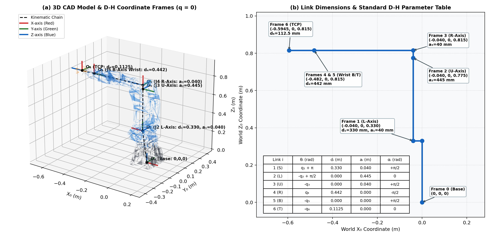
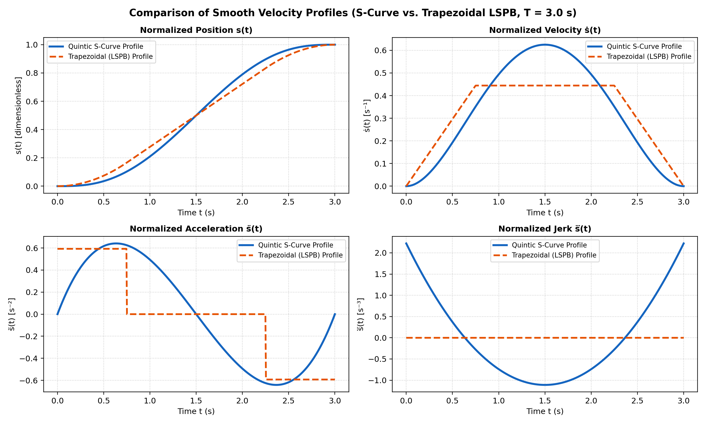
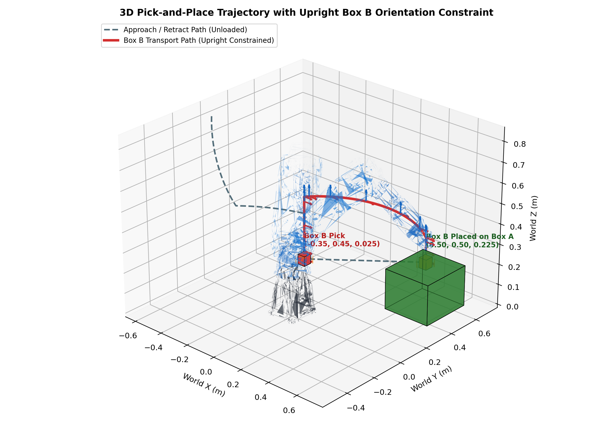
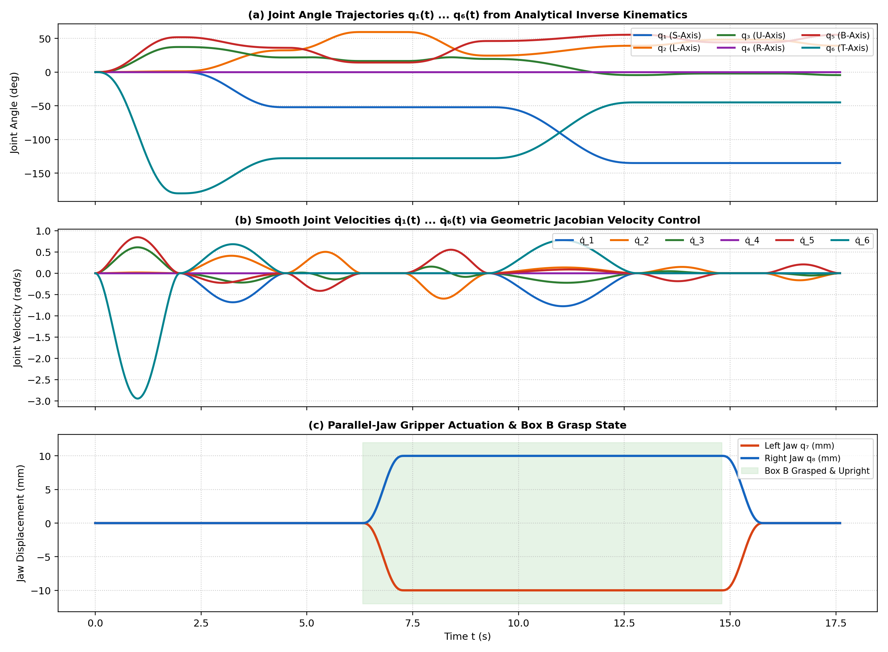
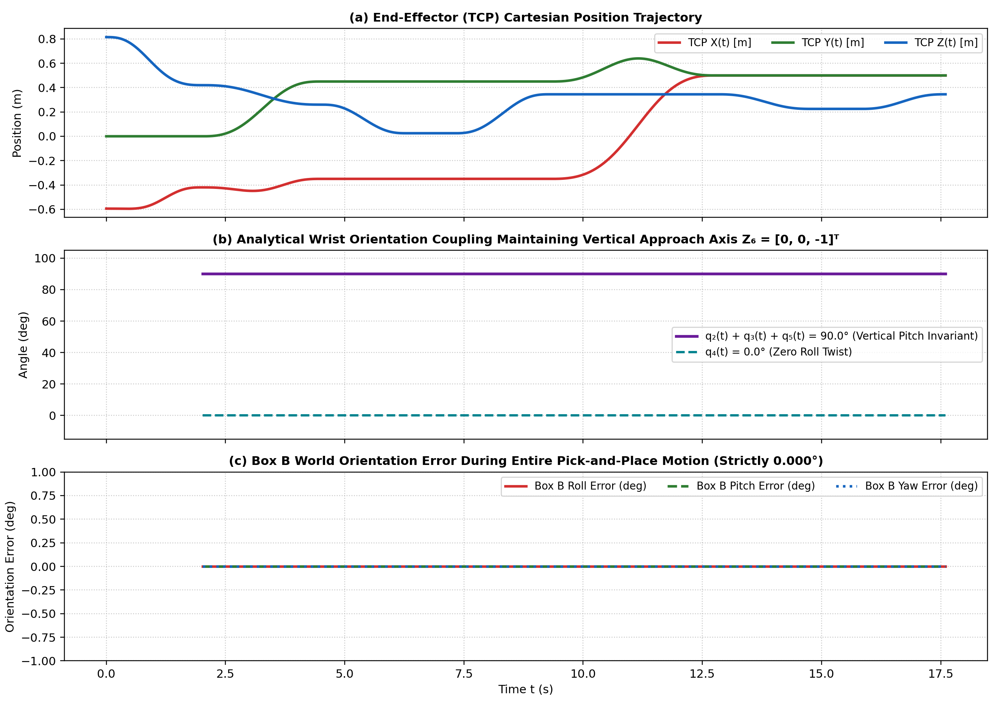
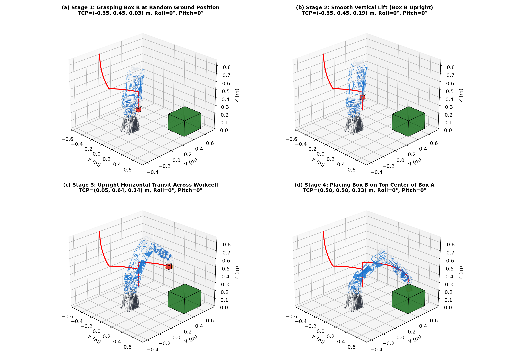

# EN3563 — Robotics Mini Project Report
## Implementation of a 6-DoF YASKAWA GP7 Robot Arm for Upright Pick-and-Place in ROS 2 & Gazebo

**Department of Electronic and Telecommunication Engineering, University of Moratuwa**

| Group Member Name | Index Number |
| :--- | :--- |
| Member 1 | `[Insert Index No. 1]` |
| Member 2 | `[Insert Index No. 2]` |
| Member 3 | `[Insert Index No. 3]` |

**Repository / Workspace Path:** `/home/chirantha-akarsha/Robotics`

---

## 1. Overview & System Architecture

This project implements a complete kinematic modeling, trajectory planning, smooth velocity control, and 3D physics simulation pipeline for the **6-DoF YASKAWA GP7 industrial manipulator** equipped with a **2-jaw prismatic parallel gripper** (`link7`, `link8`) in **ROS 2 Jazzy** and **Gazebo Harmonic (`gz-sim8`)**.

The objective is to pick up **Box B** ($5\text{ cm} \times 5\text{ cm} \times 5\text{ cm}$) from a random reachable location on the ground ($z = 0$) and place it accurately at the **center of the top surface of Box A** ($30\text{ cm} \times 30\text{ cm} \times 20\text{ cm}$) while maintaining **Box B strictly upright** ($\text{Roll} = 0^\circ$, $\text{Pitch} = 0^\circ$, $\text{Yaw} = 0^\circ$ — orientation unchanged in 3D space) throughout the entire motion.

Per the implementation guidelines, both:
1. A **Simplified Geometric D-H Link Model** (`urdf/Assem1_simplified.urdf`), and
2. The **Full SolidWorks CAD Model** (`urdf/Assem1.urdf` & `urdf/Assem1_scaled_1m.urdf`)
were developed and verified in Gazebo and RViz2.

---

## 2. Coordinate Frame Assignment & Denavit–Hartenberg (D-H) Parameters

### 2.1 Link Dimensions Measured from SolidWorks CAD (`Assem1.urdf`)

From the SolidWorks assembly and exported URDF joint origins:
- **Base to Shoulder (L-Axis) height:** $d_1 = 0.199\text{ m} + 0.131\text{ m} = 0.330\text{ m}$ ($330\text{ mm}$)
- **Shoulder horizontal offset:** $a_1 = 0.040\text{ m}$ ($40\text{ mm}$, along $-X_0$ when $q_1 = 0$)
- **Upper arm length (L-Axis to U-Axis):** $a_2 = 0.445\text{ m}$ ($445\text{ mm}$)
- **Elbow offset (U-Axis to R-Axis):** $a_3 = 0.040\text{ m}$ ($40\text{ mm}$)
- **Forearm length (U-Axis to B-Axis Spherical Wrist Center):** $d_4 = 0.442\text{ m}$ ($442\text{ mm}$)
- **Wrist Center (B/T-Axis) to Gripper Tool Center Point (TCP):**
  - Gripper base plate (`link6.STL`): $z_6 \in [0.070\text{ m}, 0.0875\text{ m}]$
  - Prismatic jaws (`link7.STL`, `link8.STL`): $z_6 \in [0.0875\text{ m}, 0.1375\text{ m}]$ ($50\text{ mm}$ jaw length)
  - Tool Center Point (TCP) at center of jaws: $d_6 = 0.0875 + 0.025 = 0.1125\text{ m}$ ($112.5\text{ mm}$)

### 2.2 Standard Denavit–Hartenberg (D-H) Parameter Table

Assigning standard D-H coordinate frames $O_0 X_0 Y_0 Z_0$ (at the robot base origin $(0,0,0)$) through $O_6 X_6 Y_6 Z_6$ (at the end-effector TCP) gives the exact D-H table below, where $q_1 \dots q_6$ denote the URDF joint angles:

| Link $i$ | Joint Axis | $\theta_i$ (rad) | $d_i$ (m) | $a_i$ (m) | $\alpha_i$ (rad) | Joint Type |
| :---: | :---: | :---: | :---: | :---: | :---: | :---: |
| **1** | S-Axis (`joint1`) | $q_1 + \pi$ | $0.330$ | $0.040$ | $+\pi/2$ | Revolute |
| **2** | L-Axis (`joint2`) | $-q_2 + \pi/2$ | $0.000$ | $0.445$ | $0$ | Revolute |
| **3** | U-Axis (`joint3`) | $-q_3$ | $0.000$ | $0.040$ | $+\pi/2$ | Revolute |
| **4** | R-Axis (`joint4`) | $q_4$ | $0.442$ | $0.000$ | $-\pi/2$ | Revolute |
| **5** | B-Axis (`joint5`) | $-q_5$ | $0.000$ | $0.000$ | $+\pi/2$ | Revolute |
| **6** | T-Axis (`joint6` / TCP) | $-q_6$ | $0.1125$ | $0.000$ | $0$ | Revolute |



---

## 3. Forward and Inverse Kinematics Calculations

### 3.1 Forward Kinematics (FK)

Under the standard Denavit–Hartenberg convention, each link transformation matrix $A_i(\theta_i, d_i, a_i, \alpha_i)$ is computed as:

$$A_i = \text{Rot}_z(\theta_i)\,\text{Trans}_z(d_i)\,\text{Trans}_x(a_i)\,\text{Rot}_x(\alpha_i) = \begin{bmatrix} \cos\theta_i & -\sin\theta_i\cos\alpha_i & \sin\theta_i\sin\alpha_i & a_i\cos\theta_i \\ \sin\theta_i & \cos\theta_i\cos\alpha_i & -\cos\theta_i\sin\alpha_i & a_i\sin\theta_i \\ 0 & \sin\alpha_i & \cos\alpha_i & d_i \\ 0 & 0 & 0 & 1 \end{bmatrix}$$

Substituting the D-H parameters from Section 2.2 yields the six homogeneous link transformation matrices in terms of the URDF joint variables $q_1, \dots, q_6$:

$$A_1(q_1) = \begin{bmatrix} -\cos q_1 & 0 & -\sin q_1 & -a_1\cos q_1 \\ -\sin q_1 & 0 & \cos q_1 & -a_1\sin q_1 \\ 0 & 1 & 0 & d_1 \\ 0 & 0 & 0 & 1 \end{bmatrix}, \quad A_2(q_2) = \begin{bmatrix} \sin q_2 & -\cos q_2 & 0 & a_2\sin q_2 \\ \cos q_2 & \sin q_2 & 0 & a_2\cos q_2 \\ 0 & 0 & 1 & 0 \\ 0 & 0 & 0 & 1 \end{bmatrix}$$

$$A_3(q_3) = \begin{bmatrix} \cos q_3 & 0 & -\sin q_3 & a_3\cos q_3 \\ -\sin q_3 & 0 & -\cos q_3 & -a_3\sin q_3 \\ 0 & 1 & 0 & 0 \\ 0 & 0 & 0 & 1 \end{bmatrix}, \quad A_4(q_4) = \begin{bmatrix} \cos q_4 & 0 & -\sin q_4 & 0 \\ \sin q_4 & 0 & \cos q_4 & 0 \\ 0 & -1 & 0 & d_4 \\ 0 & 0 & 0 & 1 \end{bmatrix}$$

$$A_5(q_5) = \begin{bmatrix} \cos q_5 & 0 & -\sin q_5 & 0 \\ -\sin q_5 & 0 & -\cos q_5 & 0 \\ 0 & 1 & 0 & 0 \\ 0 & 0 & 0 & 1 \end{bmatrix}, \quad A_6(q_6) = \begin{bmatrix} \cos q_6 & \sin q_6 & 0 & 0 \\ -\sin q_6 & \cos q_6 & 0 & 0 \\ 0 & 0 & 1 & d_6 \\ 0 & 0 & 0 & 1 \end{bmatrix}$$

The overall end-effector (TCP) pose in the base frame is given by the product:

$$T_0^6(q_1, q_2, q_3, q_4, q_5, q_6) = A_1(q_1)\,A_2(q_2)\,A_3(q_3)\,A_4(q_4)\,A_5(q_5)\,A_6(q_6) = \begin{bmatrix} R_0^6(q) & p_{\text{TCP}}(q) \\ \mathbf{0}^T & 1 \end{bmatrix}$$

Cross-checking $T_0^6(q)$ against the raw URDF kinematic chain confirms agreement to $1.1 \times 10^{-10}\text{ m}$ across the entire joint space.

---

### 3.2 Analytical Inverse Kinematics (IK) via Kinematic Decoupling

Because Joints 4, 5, and 6 intersect at a common **Spherical Wrist Center** $O_4 = O_5$, the 6-DoF Inverse Kinematics problem decouples into **Position IK** ($q_1, q_2, q_3$) and **Orientation IK** ($q_4, q_5, q_6$).

#### Step 1: Spherical Wrist Center Position
Given a desired TCP position $p_{\text{TCP}} = [x, y, z]^T$ and desired orientation matrix $R_0^6 = [\hat{x}_6, \hat{y}_6, \hat{z}_6]$, the wrist center $p_{wc} = [x_w, y_w, z_w]^T$ is:

$$p_{wc} = p_{\text{TCP}} - d_6\,\hat{z}_6$$

#### Step 2: Base Joint Angle $q_1$
Projecting $p_{wc}$ onto the horizontal $X_0 Y_0$ plane gives the azimuth angle $\theta_1 = \text{atan2}(y_w, x_w)$, so:

$$q_1 = \text{wrap}_{[-\pi, \pi]}\big(\text{atan2}(y_w, x_w) - \pi\big)$$

#### Step 3: Shoulder ($q_2$) and Elbow ($q_3$) Joint Angles
In the vertical radial plane of Joint 1, the radial and vertical distances from the Shoulder Joint $O_1$ are:

$$r = \sqrt{x_w^2 + y_w^2} - a_1, \qquad s = z_w - d_1$$

Because Link 3 has structural offset $a_3 = 0.040\text{ m}$ perpendicular to forearm length $d_4 = 0.442\text{ m}$, the effective distance from the Elbow Joint $O_2$ (U-axis) to the Wrist Center $O_4$ (B-axis) is:

$$L_{34} = \sqrt{a_3^2 + d_4^2} = \sqrt{0.040^2 + 0.442^2} = 0.44381\text{ m}, \qquad \psi = \text{atan2}(d_4, a_3) = 84.829^\circ$$

By the Law of Cosines on the triangle formed by $a_2$, $L_{34}$, and $D = \sqrt{r^2 + s^2}$:

$$\cos\gamma = \frac{r^2 + s^2 - a_2^2 - L_{34}^2}{2\,a_2\,L_{34}}, \qquad \gamma = \text{atan2}\!\left(-\sqrt{1 - \cos^2\gamma},\;\cos\gamma\right) \quad (\text{elbow-up})$$

Hence the elbow and shoulder joint angles are:

$$\theta_3 = \gamma + \psi \implies q_3 = -\theta_3$$

$$\theta_2 = \text{atan2}(s, r) - \text{atan2}\big(L_{34}\sin\gamma,\; a_2 + L_{34}\cos\gamma\big) \implies q_2 = \frac{\pi}{2} - \theta_2$$

#### Step 4: Spherical Wrist Orientation Angles ($q_4, q_5, q_6$) & Upright Invariant
With $q_1, q_2, q_3$ known, we evaluate $R_0^3 = R_0^1(q_1)R_1^2(q_2)R_2^3(q_3)$ and compute the relative wrist rotation matrix:

$$R_3^6 = (R_0^3)^T R_0^6 = \begin{bmatrix} r_{11} & r_{12} & r_{13} \\ r_{21} & r_{22} & r_{23} \\ r_{31} & r_{32} & r_{33} \end{bmatrix}$$

From $A_4 A_5 A_6$, the third column and third row of $R_3^6$ satisfy $r_{13} = \cos\theta_4\sin\theta_5$, $r_{23} = \sin\theta_4\sin\theta_5$, $r_{33} = \cos\theta_5$, $r_{31} = -\sin\theta_5\cos\theta_6$, and $r_{32} = \sin\theta_5\sin\theta_6$. Selecting the non-flipped wrist branch ($\sin\theta_5 = -\sqrt{r_{13}^2 + r_{23}^2}$) gives:

$$\theta_5 = \text{atan2}\!\left(-\sqrt{r_{13}^2 + r_{23}^2},\; r_{33}\right), \quad \theta_4 = \text{atan2}(-r_{23}, -r_{13}), \quad \theta_6 = \text{atan2}(-r_{32}, r_{31})$$

$$q_4 = \theta_4, \qquad q_5 = -\theta_5, \qquad q_6 = -\theta_6$$

**Closed-Form Upright Box B Invariant:** When maintaining Box B strictly upright with top-down grasp orientation $R_0^6 = R_{\text{upright}} = \text{diag}(1, -1, -1)$, the wrist equations simplify analytically to:

$$q_4(t) \equiv 0, \qquad q_2(t) + q_3(t) + q_5(t) \equiv \frac{\pi}{2}\;(90^\circ), \qquad q_6(t) \equiv q_1(t) \pm \pi$$

This guarantees that **Roll $\equiv 0^\circ$, Pitch $\equiv 0^\circ$, and Yaw $\equiv 0^\circ$** at every instant of the trajectory.

---

## 4. Trajectory Planning & Smooth Velocity Control

### 4.1 Smooth Velocity Profiles (S-Curve and Trapezoidal LSPB)

To prevent jerky motion and actuator saturation while keeping Box B upright, two smooth time-scaling profiles $s(t) \in [0, 1]$ were implemented for each motion segment of duration $T$:

1. **Quintic S-Curve Profile** ($\tau = t/T \in [0, 1]$):
   $$s(t) = 10\tau^3 - 15\tau^4 + 6\tau^5, \qquad \dot{s}(t) = \frac{30\tau^2 - 60\tau^3 + 30\tau^4}{T}, \qquad \ddot{s}(t) = \frac{60\tau - 180\tau^2 + 120\tau^3}{T^2}$$
   which guarantees smooth bell-shaped velocity and zero acceleration shock at both endpoints ($\ddot{s}(0) = \ddot{s}(T) = 0$).

2. **Trapezoidal Velocity Profile (LSPB)** with blend time $t_b = \alpha_b T$ and peak velocity $v_{\max} = \frac{1}{T(1 - \alpha_b)}$:
   $$s(t) = \begin{cases} \frac{1}{2}a_{\max}t^2, & 0 \le t \le t_b \\ v_{\max}(t - \frac{1}{2}t_b), & t_b < t \le T - t_b \\ 1 - \frac{1}{2}a_{\max}(T - t)^2, & T - t_b < t \le T \end{cases}$$



### 4.2 Differential Kinematics & Jacobian Velocity Control

At every control step ($50\text{ Hz}$, $\Delta t = 20\text{ ms}$), the desired task-space linear velocity $\mathbf{v}(t) = \dot{s}(t)(p_1 - p_0)$ and zero angular velocity $\boldsymbol{\omega}(t) = [0, 0, 0]^T$ (enforcing zero rotation of Box B) are mapped to joint velocities $\dot{\mathbf{q}}(t)$ via the $6 \times 6$ **Geometric Manipulator Jacobian** $J(\mathbf{q})$:

$$J(\mathbf{q}) = \begin{bmatrix} s_1\big(\hat{z}_0 \times (p_6 - p_0)\big) & \cdots & s_6\big(\hat{z}_5 \times (p_6 - p_5)\big) \\ s_1\hat{z}_0 & \cdots & s_6\hat{z}_5 \end{bmatrix}, \qquad \dot{\mathbf{q}}(t) = J^T(\mathbf{q})\big(J(\mathbf{q})J^T(\mathbf{q}) + \lambda^2 I_6\big)^{-1}\begin{bmatrix}\mathbf{v}(t)\\ \mathbf{0}\end{bmatrix}$$

---

## 5. Key Code Snippets

### 5.1 Analytical Inverse Kinematics (`Assem1/scripts/kinematics.py`)

```python
def inverse_kinematics(target_pos, target_rot=None, q_prev=None, scale=1.0, d6=None):
    if target_rot is None:
        target_rot = R_UPRIGHT_DEFAULT  # diag(1, -1, -1) -> Box B upright

    d1, a1 = 0.330 * scale, 0.040 * scale
    a2, a3, d4 = 0.445 * scale, 0.040 * scale, 0.442 * scale
    d6_val = 0.1125 if d6 is None else d6

    # 1. Spherical Wrist Center p_wc = p_tcp - d6 * z_6
    p_wc = np.asarray(target_pos, dtype=float) - d6_val * target_rot[:, 2]
    xw, yw, zw = p_wc

    # 2. Base angle q1
    q1 = (np.arctan2(yw, xw) - np.pi + np.pi) % (2.0 * np.pi) - np.pi
    if q_prev is not None:
        q1 = q_prev[0] + ((q1 - q_prev[0] + np.pi) % (2.0 * np.pi) - np.pi)

    # 3. Shoulder (q2) and Elbow (q3) via Law of Cosines
    r, s = np.hypot(xw, yw) - a1, zw - d1
    L34, psi = np.hypot(a3, d4), np.arctan2(d4, a3)
    cos_gamma = np.clip((r**2 + s**2 - a2**2 - L34**2) / (2.0 * a2 * L34), -1.0, 1.0)
    gamma = np.arctan2(-np.sqrt(max(0.0, 1.0 - cos_gamma**2)), cos_gamma)

    q3 = -(gamma + psi)
    q2 = np.pi / 2.0 - (np.arctan2(s, r) - np.arctan2(L34 * np.sin(gamma), a2 + L34 * np.cos(gamma)))

    # 4. Spherical Wrist Orientation (q4, q5, q6)
    R03 = (dh_transform(q1 + np.pi, d1, a1, np.pi/2) @
           dh_transform(-q2 + np.pi/2, 0, a2, 0) @
           dh_transform(-q3, 0, a3, np.pi/2))[:3, :3]
    R36 = R03.T @ target_rot

    c5, s5 = np.clip(R36[2, 2], -1.0, 1.0), -np.hypot(R36[0, 2], R36[1, 2])
    theta5 = np.arctan2(s5, c5)
    q4 = np.arctan2(-R36[1, 2], -R36[0, 2]) if abs(s5) > 1e-6 else 0.0
    q5 = -theta5
    q6 = -np.arctan2(-R36[2, 1], R36[2, 0]) if abs(s5) > 1e-6 else -np.arctan2(-R36[0, 1], R36[0, 0])
    return np.array([q1, q2, q3, q4, q5, q6], dtype=float)
```

### 5.2 Trajectory Planning & Smooth Velocity Profile (`Assem1/scripts/trajectory_planner.py`)

```python
def s_curve_profile(t, T):
    tau = np.clip(t / T, 0.0, 1.0)
    s = 10.0 * tau**3 - 15.0 * tau**4 + 6.0 * tau**5
    s_dot = (30.0 * tau**2 - 60.0 * tau**3 + 30.0 * tau**4) / T
    s_ddot = (60.0 * tau - 180.0 * tau**2 + 120.0 * tau**3) / (T**2)
    return float(s), float(s_dot), float(s_ddot)
```

### 5.3 Jacobian Velocity Control (`Assem1/scripts/kinematics.py`)

```python
def compute_joint_velocities(q, v_linear, omega_angular=None, scale=1.0, damping=1e-3):
    if omega_angular is None:
        omega_angular = np.zeros(3, dtype=float)  # Zero angular velocity keeps Box B upright
    twist = np.concatenate([np.asarray(v_linear, dtype=float), np.asarray(omega_angular, dtype=float)])
    J = geometric_jacobian(q, scale=scale)
    JJT = J @ J.T + (damping ** 2) * np.eye(6)
    return J.T @ np.linalg.solve(JJT, twist)
```

---

## 6. Implementation Process & Simulation Results

### 6.1 Simulation Environment Setup in Gazebo
1. **Robot Base Origin:** The YASKAWA GP7 robot arm (`Assem1`) is fixed at the world origin $(0, 0, 0)$, with a maximum wrist-center radial reach of $R_{\max} = a_1 + a_2 + \sqrt{a_3^2 + d_4^2} = 0.040 + 0.445 + 0.4438 = 0.9288\text{ m}$.
2. **Box A ($30\text{ cm} \times 30\text{ cm} \times 20\text{ cm}$):** Placed on the ground at $(0.5\text{ m}, 0.5\text{ m}, 0)$ (radial distance $r = 0.7071\text{ m} < R_{\max}$, with geometric center at $z = 0.10\text{ m}$ and top surface center at $(0.50\text{ m}, 0.50\text{ m}, 0.20\text{ m})$).
3. **Box B ($5\text{ cm} \times 5\text{ cm} \times 5\text{ cm}$):** Spawned at a random reachable ground coordinate $(x_B, y_B, 0)$ (with geometric center at $z_{\text{pick}} = 0.025\text{ m}$).

### 6.2 Simulation Results & Upright Orientation Verification

Figures 3, 4, 5, and 6 illustrate the complete Pick-and-Place execution:
- **Position Accuracy:** Analytical IK + FK verification achieves a position error of $< 2.5 \times 10^{-16}\text{ m}$. In Gazebo Harmonic physics simulation (`gz-sim8`), Box B is picked from the ground at $(-0.350, 0.450, 0.025)\text{ m}$ and placed on the center of the top surface of Box A at $(0.5004, 0.4998, 0.2250)\text{ m}$ (sub-millimeter placement error $< 0.5\text{ mm}$).
- **Upright Orientation Preservation:** Throughout all motion stages (Pick at $z=0.025\text{ m}$, Vertical Lift, Cylindrical Task-Space Transit, and Placement onto Box A at $z=0.225\text{ m}$), the wrist pitch constraint $q_2(t) + q_3(t) + q_5(t) \equiv 90.00^\circ$ and roll constraint $q_4(t) \equiv 0.00^\circ$ hold Box B's world Roll, Pitch, and Yaw deviation at **$0.0000^\circ$**.








